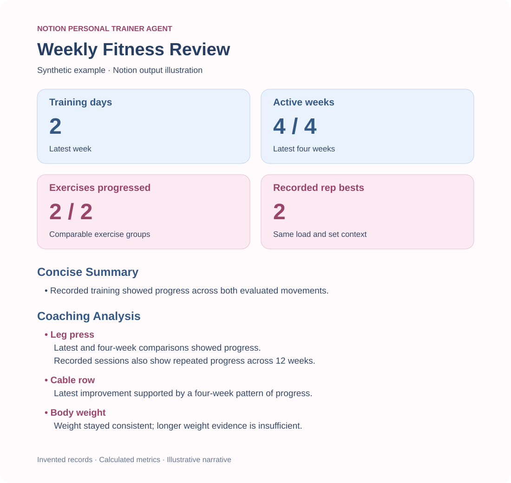
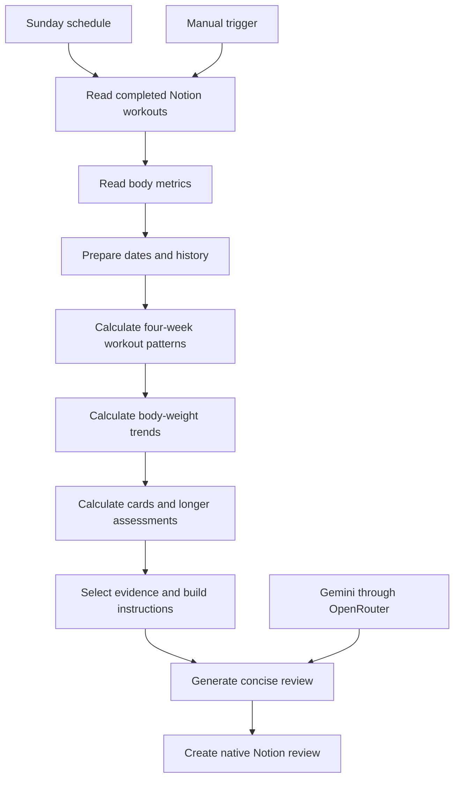

# Notion Personal Trainer Agent

**A scheduled fitness-review assistant built with Notion, n8n, and Gemini through OpenRouter.** It turns recorded workouts and body-weight entries into a concise weekly review, with a blue-and-pink headline dashboard and evidence-based coaching bullets.

The core design is **calculate → select evidence → explain → write the review**. Code establishes the facts and selects findings before AI writes the explanation. The assistant reports recorded performance; it does not autonomously prescribe workouts or change the training program.



*Illustrative preview using synthetic records. No personal fitness data is included in this repository. Native Notion rendering may differ slightly from this illustration.*

## The problem

Recording a workout is easy. Reviewing several weeks of working-set loads, repetitions, and body metrics takes more effort. Giving raw logs to AI can also produce different highlights on each run or conclusions that sparse data cannot support.

This project keeps Notion as the familiar logging interface and automates the preparation of a review. Fixed rules make comparisons and finding selection reproducible; AI turns the selected evidence into readable coaching. The intended value is less manual analysis and more consistent reviews. Time savings and ROI have not been measured.

## What it does

- Reads completed workout history and body metrics from Notion.
- Calculates the latest session comparison and a separate four-week pattern.
- Selects up to two positive weekly examples and one finding to monitor.
- Builds four calculated cards: training days, active weeks, exercises progressed, and recorded rep bests.
- Evaluates rolling **8- and 12-week** workout patterns only when history, coverage, and comparability requirements qualify.
- Includes at most one useful longer finding, avoiding repeated 8-/12-week explanations.
- Assesses body-weight maintenance using weekly averages and minimum recorded-day requirements.
- Generates a high-level summary, coaching analysis, and practical priorities in native Notion bullets.
- Runs Sundays at 9 a.m. in `America/New_York`; a manual trigger remains available.
- Writes only new review pages. Workout records and training plans remain under the user's control.

## Workflow



## Design decisions

| Decision | Why |
|---|---|
| Notion remains the main interface | Preserve quick workout logging and avoid adding another app. |
| One row per exercise performed | Retain working-set detail without requiring a row for every set. |
| Calculate and select before AI generation | Keep categories, metrics, and highlighted exercises repeatable. |
| Separate session changes from longer patterns | Avoid calling one weaker session a sustained decline. |
| Require evidence coverage for 8-/12-week results | Calendar age alone does not establish a useful trend. |
| Treat gaps as unknown | Avoid invented stability, progress, or weight drift during missing weeks. |
| Keep the summary qualitative | Reduce duplication with cards and exercise-specific detail. |
| Explain only selected historical evidence | Keep the AI input compact rather than sending the full historical log. |

### Accuracy rules

Compare corresponding working-set positions within the same exercise, session group, and training block. More load with fewer repetitions is mixed change. Changed set count cannot establish strength progress. Bodyweight movements without external loads are excluded from performance commentary, while completed records can count toward logged activity.

Four-week patterns require at least three valid sessions spanning 14 days. Eight-week assessments require at least six usable sessions across six different weeks; twelve-week assessments require nine across nine weeks. Both require mature recorded history, early-window evidence, a latest-week session, and unambiguous comparisons. A new training block has its own evidence requirements.

Weight comparisons require at least three distinct recorded days in each adjacent week. A change of 1 lb or less is consistent under this project's agreed maintenance rule. Gradual drift requires consecutive sufficiently tracked weeks; missing weeks break that sequence.

These are project reporting rules, not universal physiological cutoffs. They do not establish fatigue, muscle growth, body-fat change, a plateau, or the cause of a result.

## Review format

The writer inserts the calculated **Weekly Snapshot** cards independently of AI. The AI is instructed to keep the remaining review below 500 words:

1. **Concise Summary:** A high-level training takeaway without repeated card counts or exercise details.
2. **Coaching Analysis:** Selected exercise bullets, optional longer context, and exactly one body-weight assessment.
3. **Practical Priorities:** Up to three distinct, supported priorities; continuing without changes is valid.

The model's wording can vary. Prompt instructions guide it but do not guarantee that every sentence is accurate or that the word limit is enforced.

## Explore or reproduce

- [Importable n8n workflow](workflows/weekly-fitness-review.json)
- [Setup guide](docs/setup.md)
- [Notion schema](docs/notion-schema.md)
- [Dashboard definitions](docs/dashboard-and-longer-windows.md)
- [Longer-window eligibility](docs/longer-trend-eligibility-draft.md), [classification](docs/longer-trend-classification-draft.md), and [report selection](docs/longer-trend-reporting-draft.md)
- [Synthetic sample review](examples/synthetic-review.md)
- [Validation evidence and limitations](docs/validation.md)

The workflow export is deliberately **inactive**, with credential references removed and destination identifiers replaced by placeholders. Connect your own accounts and select your own Notion data sources and review parent page before testing. n8n supports importing workflow JSON through its editor. [n8n import/export documentation](https://docs.n8n.io/build/manage-workflows/export-and-import.md)

Run the local checks with Node.js; no packages or API calls are required:

```sh
node tests/longer-assessments.cjs
node tests/core-rules.cjs
node tests/package-check.cjs
```

## Validation and current status

The personal deployment is published with its Sunday schedule. Manual end-to-end tests retrieved Notion records, calculated evidence, generated reviews, and created formatted pages. The latest longer-window update completed its manual test in approximately 15.5 seconds. A successful scheduled run has not been independently verified.

The repository includes reproducible synthetic checks for longer-window boundaries, gaps, invalid data, comparison categories, deterministic selection, payload separation, and native block conversion. A real qualifying longer-window AI review remains a future verification point because the current deployment has not yet accumulated qualifying history.

## Operational limits

- Every successful run creates a new page; reruns can create duplicate reviews.
- The export has no explicit node retry policy or dedicated error-alert workflow.
- The writer guards against blank review text, missing card data, and more than 100 blocks. Recovery from external API failures has not been validated.
- Recorded data cannot establish prescribed loads, effort, technique, adherence, or why performance changed. Training-plan prescriptions are not included in the AI input.
- AI wording remains a separate quality-control concern even when calculations are correct.
- All completed history is retrieved for rep-best comparisons and longer assessments. Larger histories may need a different retrieval strategy.
- Costs depend on the chosen model, input length, output, and run frequency. Monthly cost has not been measured.

## Scope

This project covers progressive overload and body-weight maintenance. It excludes nutrition, macros, steps, sleep, mood, and automatic training-plan edits. Circumference measurements are reserved for a separate monthly review, which is not implemented here.

Potential next steps are verified scheduled-run monitoring, duplicate protection, factual output validation, and a monthly circumference review.
